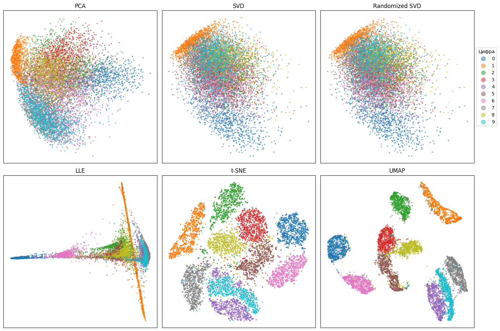
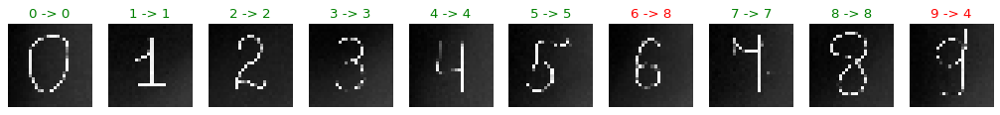
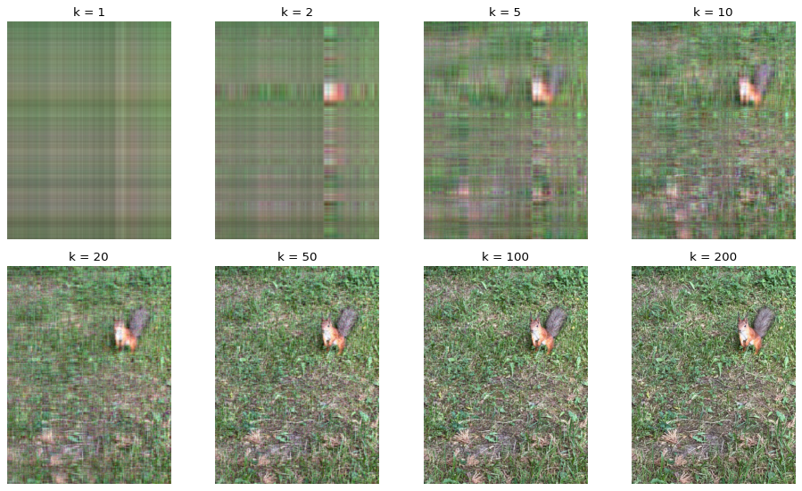
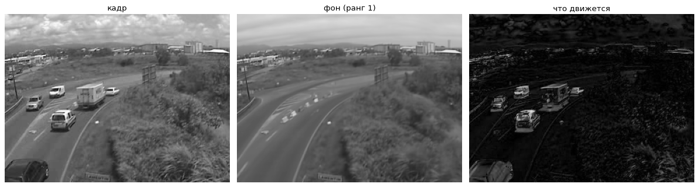
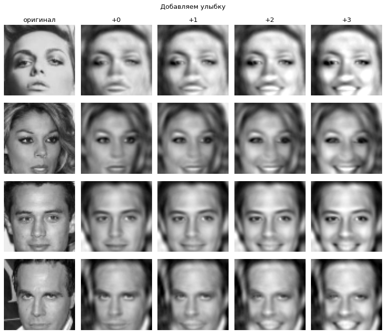

# Снижение размерности: MNIST, сжатие картинок, фон на видео

Несколько задач без учителя, в которых данные сжимаются в маленькую размерность: PCA, SVD, NMF, t-SNE, UMAP и LLE на рукописных цифрах, сжатие фотографий через SVD, отделение фона на видео с уличной камеры и бонус, где лицу добавляется улыбка.

## Что сделано

- **MNIST:** картинки 28x28 (784 пикселя) сжаты до 2 чисел шестью методами. Методы сравниваются по тому, насколько хорошо в 2D разделяются цифры: kNN accuracy на кросс-валидации, silhouette и время.
- **Свои цифры:** UMAP + kNN, обученные на MNIST, сохранены и в `predict_my_digits.ipynb` распознают цифры, нарисованные мной от руки.
- **Сжатие картинок:** SVD с разным рангом, спектр сингулярных чисел и объяснённая дисперсия: сколько компонент нужно, чтобы картинка выглядела нормально.
- **Фон на видео:** кадры видео складываются в одну матрицу, фон получается из первой компоненты SVD, а то, что движется, из разности кадра и фона.
- **Лица (CelebA):** "направление улыбки" в пространстве PCA (разница среднего улыбающегося и среднего неулыбающегося лица) и компоненты NMF.
- **Теория:** коротко своими словами про проклятие размерности, разницу PCA, SVD и NMF, как устроены LLE, t-SNE и UMAP.

## Результаты

### MNIST, 2 компоненты (подвыборка 10 тыс.)

| Метод | kNN accuracy | Silhouette | Время, с |
|---|---|---|---|
| t-SNE | **0.948** | 0.337 | 21.0 |
| UMAP | 0.943 | **0.424** | 12.4 |
| LLE | 0.744 | 0.078 | 36.2 |
| PCA | 0.411 | 0.017 | 0.2 |
| SVD | 0.305 | -0.034 | 0.3 |
| Randomized SVD | 0.305 | -0.034 | 0.1 |
| без сжатия (784 пикселя) | 0.943 | 0.043 | |

t-SNE и UMAP сжимают цифру до 2 чисел почти без потерь: kNN по ним угадывает столько же, сколько по всем 784 пикселям. Линейные методы в 2D дают кашу. UMAP, обученный на всех 60 тыс. картинок, на отложенных 10 тыс. даёт accuracy 0.954.



### Свои рукописные цифры

Угадано 8 из 10: 6 принята за 8, а 9 за 4. Мои цифры нарисованы тонкой пунктирной линией на сером фоне, а в MNIST линии толстые и фон чёрный.



### Сжатие картинок

Чистой шахматной доске хватает 2 компонент, тексту 20-30, фото белки на траве нужно 100-200 из 1920: мелкая текстура сжимается хуже всего.



### Фон на видео

Для фона хватает ранга 1: фон почти не меняется между кадрами, а машины в первую компоненту не попадают.



### Улыбка на лице

На 10 тыс. выровненных лиц из CelebA "направление улыбки" в PCA работает: на шаге +1 и +2 человек узнаётся, а улыбка появляется, дальше лицо уходит в среднюю улыбку. NMF на тех же лицах находит отдельные части: рот с зубами, нос, лоб, волосы.



## Как запустить

```bash
pip install -r requirements.txt
```

MNIST и CelebA скачиваются сами (CelebA через `kagglehub`, около 1.4 ГБ). Остальные данные (видео, картинки) нужно положить в `data/`, что именно, написано в [data/README.md](data/README.md). Сначала запускается `dimensionality_reduction.ipynb`: он сохраняет модели в `models/`, потом `predict_my_digits.ipynb`.

**Стек:** Python, NumPy, pandas, scikit-learn, umap-learn, OpenCV, matplotlib.
